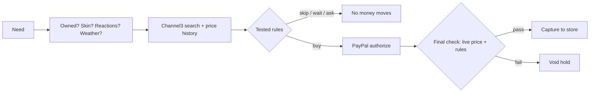

# Shelfie

**The shopping agent that learns when not to buy.**

Shelfie knows what you already own across your wardrobe, skincare and makeup, how your skin has been, what reacted badly, and what things really cost over time. Before it spends a cent it checks all of that, and it often says no: "you own four black tops", "this has the ingredient that stung you", "it was cheaper last week". When it does buy, PayPal holds the money, the agent re-checks the live price, and only then pays the store.

Built for the PayPal AI Hackathon (Devpost, 2026). Android app plus a small Node server. PayPal runs in sandbox only.

## Why

- **People rebuy what they own.** 76% of US adults have bought something they already had because they forgot ([TopCashback, n=2,500, Jul 2026](https://www.prweb.com/releases/over-90-of-americans-are-paying-an-invisible-forgetfulness-tax-new-research-reveals-302837339.html)). A quarter of UK wardrobes hasn't been worn in a year ([WRAP, n>6,000](https://wrap.ngo/media-centre/press-releases/nations-wardrobes-hold-16-billion-items-unworn-clothes-people-open-new)).
- **Skin reacts, and people forget why.** 71% of adults report some sensitive skin ([meta-analysis, ~51,800 people](https://pubmed.ncbi.nlm.nih.gov/31869523/)). After patch testing, patients forgot over 40% of their own allergens ([Mayo Clinic, n=757](https://mayoclinic.elsevierpure.com/en/publications/patients-perceptions-of-the-usefulness-and-outcome-of-patch-testi)).
- **Discounts mislead, and AI advice is distrusted.** 92% of 227 Black Friday "deals" were the same price or cheaper at another time ([Which?](https://www.which.co.uk/policy-and-insight/article/nine-in-10-black-friday-deals-cheaper-or-same-price-at-other-times-of-the-year-which-finds-a4Z2J3u5lTI2)). 43% of beauty shoppers worry AI recommends what's paid for, not what fits ([Harris Poll, n=3,222](https://theharrispoll.com/articles/what-beauty-consumers-want-from-ai/)).

Closet apps track what you own but never buy. Skincare apps log reactions but never stop a purchase. Shopping agents buy, but don't know what you own. Shelfie joins the three.

## What it does

| | |
| --- | --- |
| **Today** | The agent's recent calls, skips first, each with its evidence. Live UV and humidity. Today's outfit from your own closet. |
| **Closet** | Photo grid, wear counts, "you own 4 black tops" warnings, and looks styled from your real pieces with gpt-image. |
| **Skin** | Daily check-in, morning and evening products, how your skin feels, and **what works on you**: each product compared on days used versus not used. |
| **Makeup** | Shade palette, open dates, the last look the agent saw. |
| **Agent** | Chat, hold-to-talk, or a **live voice call** (GPT-Live 1 over WebRTC at `/live`: the voice model talks and hands every action to the same agent). It acts through tools: adds items, logs the diary, remembers preferences, turns a reaction into a tested rule, styles looks, checks purchases, watches prices, answers money questions and prepares refunds you confirm. |
| **Ledger** | `/ledger` on the server: every decision with its price history, rule and PayPal trail, a 112-product price observatory, and how the rules changed. Built with AG Grid. |

Getting things in: one photo of a shelf or rail (the model reads it, you confirm), a pasted receipt or order email, or just telling the agent.

## How the agent decides

1. **Earn context first.** What you own and how long it will last, your skin timeline and diary, reactions, preferences, today's weather, and our own price history: Channel3's ~30 days saved at seed time plus a daily snapshot of 112 products since 2 Nov 2026.
2. **Rules, not vibes.** Buy, wait, skip or ask comes from a small rule language stored as data (`server/lib/policy.mjs`). Models read photos and write text; they never decide money. When you report a reaction, the agent writes a new rule **with tests**, and it only goes live if every old and new test passes. Model-written code never runs.
3. **Channel3 in layers.** Identify products (text or a product crop), details and variants, similar products when the first match fails a rule, and its price history as a second opinion.
4. **PayPal as the decision's state machine.** You approve once in PayPal, which saves the method. For each purchase the agent **authorizes** at purchase time, re-checks the live price and the rules, then **captures** to the store or **voids** the hold. Refunds go through PayPal too. Every step's ID shows in the app and the ledger.
5. **Waiting is an action.** A "wait" or "ask" can become a price watch, written by the agent or set by you. Every few hours the server checks live prices; when one fires, the same tested rules run again on the new price with no model call. If they say buy and PayPal is approved, it buys through the same authorize, final check, capture or void. Refunds can only be prepared by the agent; your tap moves the money.



## Run it

Needs Node 22+ and, for the APK, JDK 17 and the Android SDK.

```sh
cp .env.example .env.local      # PayPal sandbox keys, OpenAI key; Channel3 works without a key
npm start                        # API server on http://localhost:8095, starts from the demo bundle
npm run build:web                # web app, then open http://localhost:8095
npm test                         # rule language, engine, analysis and agent tests
```

A fresh clone starts from `server/demo`: the seeded persona, its photos, and a copy of our price log, so nothing needs to be generated or paid for. To rebuild the persona with the real engine, run `npm run seed` (a few cents of model calls), then `npm run demo:bundle`.

- **Hosted demo:** `render.yaml` deploys the server, web app and ledger as one Render service. Add the secrets in the dashboard and set `PUBLIC_URL` to the service URL. With `PUBLIC_DEMO=1`, a reset returns to the demo persona, and `OPENAI_DAILY_CAP` keeps public model spend low.

- **Android:** set `EXPO_PUBLIC_API_URL=http://<your-pc-ip>:8095` in `mobile/.env.local`, then `npm run apk` (Windows-friendly: builds from a short path to avoid path-length limits). The APK lands in `dist/shelfie.apk`.
- **Ledger:** http://localhost:8095/ledger
- **Live voice:** http://localhost:8095/live (the microphone needs localhost or https, so on a phone use the hosted URL)
- **PayPal:** the first purchase opens PayPal for one approval with a sandbox buyer. Set `STORE_SANDBOX_EMAIL` to a second sandbox Business account to pay a separate store; without it, the demo pays the app's own sandbox merchant and says so.

## Honest limits

- PayPal sandbox only, simulated money. Delivery isn't part of the demo.
- Demo data is labelled in the app. Face samples are generated images of a fictional person. The bundled price log is a copy; the live one grows daily on our logging machine.
- Skin readings describe appearance only, never diagnose, and can shift with lighting; the app says so. Selfies go only to the vision model and aren't stored; only the text reading is.
- Product photos sent for search are crops, never faces.
- Channel3 mostly covers US stores in USD.
- In production, paying stores directly would use PayPal's marketplace onboarding rather than an app-held payee.
- Live voice calls cannot be hung up from the server, so the server allows one call at a time and `LIVE_ENABLED=0` turns them off (the default in `render.yaml`). On a free host the daily model-spend ledger resets when the instance restarts.

## Built with

PayPal Orders v2 (vault, authorize, capture, void, refund) · Channel3 · OpenAI GPT-6 Luna, GPT-Live 1, gpt-image, speech · Open-Meteo · AG Grid Community · Expo / React Native.

## Repo

- `server/`: API, agent, rules, PayPal, Channel3, price log, tests
- `server/demo/`: the demo bundle (persona snapshot, photos, price log copy, generated faces)
- `mobile/`: the Expo app (Android and web)
- `web/ledger.html`: AG Grid ledger
- `scripts/`: APK and web builds
- `prototypes/`: earlier experiments

## License

MIT
